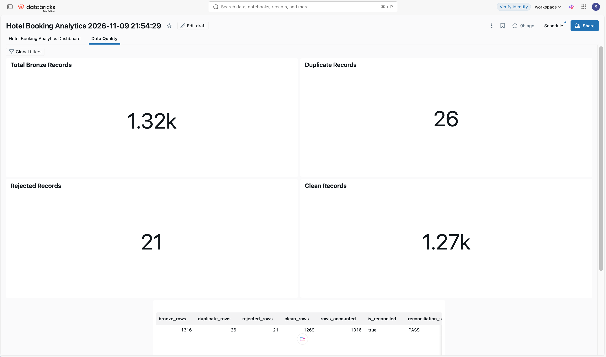
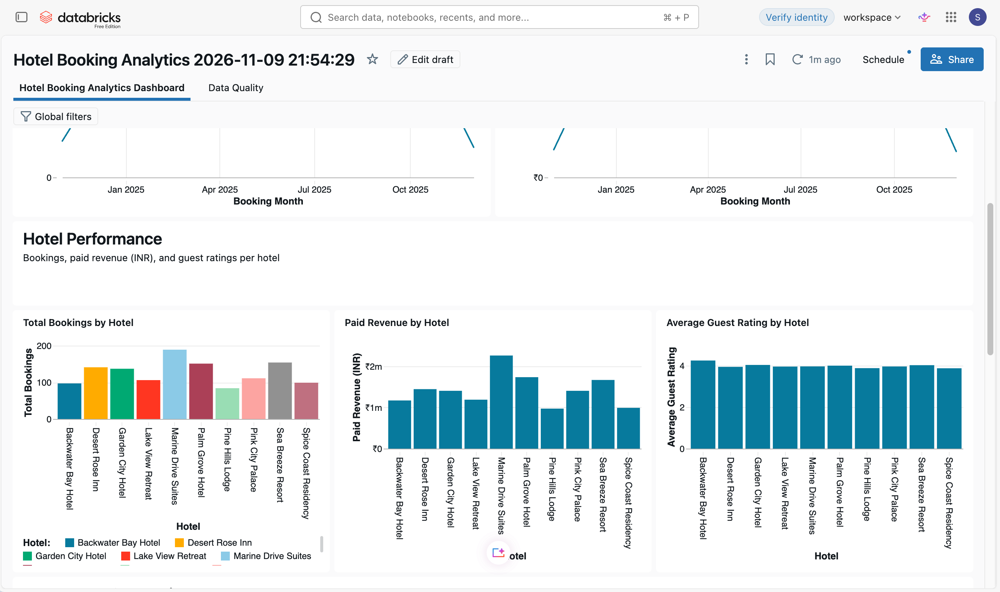
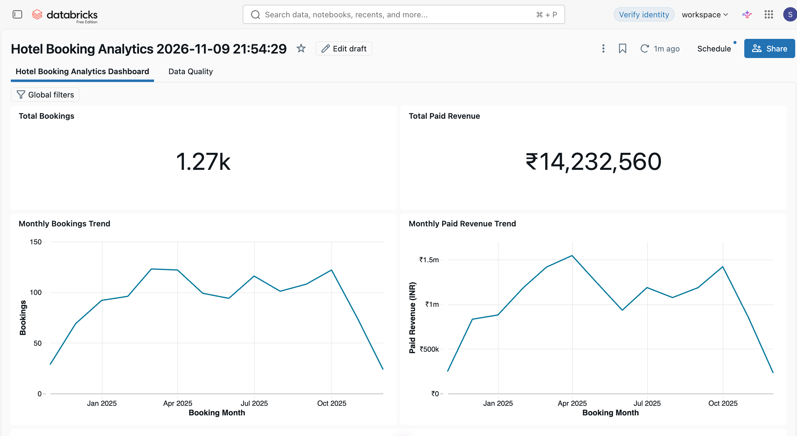
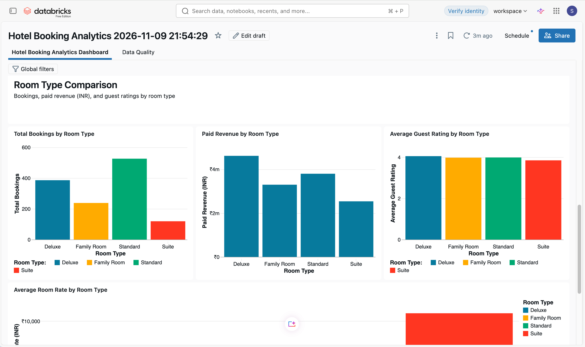
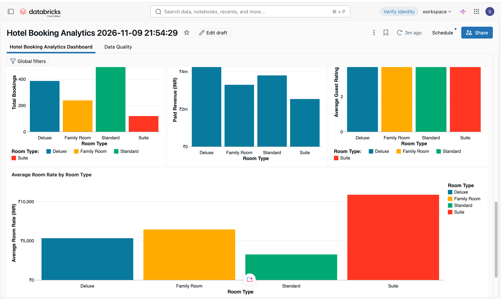

# Hotel Booking Analytics

## Project Overview

This project analyzes hotel booking data to understand booking trends, hotel performance, revenue, customer ratings, room types, booking channels and data quality.

The project uses Medallion Architecture (Bronze, Silver and Gold) to process raw booking data into clean, analysis-ready datasets.

## 1. Tools and Technologies

- Python
- SQL
- Databricks
- Delta Tables
- Power BI
- GitHub

## 2. Project Architecture

Bronze Layer → Silver Layer → Gold Layer → Power BI

- Bronze: Raw booking data (1,316 records)
- Silver: Cleaned and validated data (1,269 records)
- Gold: Aggregated analytical tables
- Power BI: Interactive dashboards and business insights

## 3. Data Quality Analysis

The project identified and handled duplicate and invalid booking records.

| Data Quality Metric | Count |
|---|---:|
| Total Bronze Records | 1,316 |
| Unique Bookings | 1,290 |
| Duplicate Records | 26 |
| Clean Silver Records | 1,269 |
| Rejected Records | 21 |

### Rejection Breakdown

| Rejection Reason | Count |
|---|---:|
| Invalid Checkout Date | 12 |
| Negative Room Rate | 9 |
| **Total** | **21** |

## 4. Gold-Layer Analytical Tables

| Table | Purpose |
|---|---|
| `gold_monthly_bookings` | Monthly booking trends |
| `gold_hotel_performance` | Hotel-wise performance |
| `gold_city_performance` | City-wise booking and revenue |
| `gold_channel_performance` | Booking-channel analysis |
| `gold_room_performance` | Room-type performance |
| `gold_data_quality` | Data-quality metrics |

Other summary tables are also available in the Gold layer.

## 5. Key Business Insights

- Goa recorded the highest booking volume and paid revenue among cities with identified names.
- Marine Drive Suites recorded the highest bookings and paid revenue among hotels.
- Backwater Bay Hotel had the highest average guest rating.
- Mobile App had the highest booking volume among booking channels.
- Website generated the highest paid revenue among booking channels.
- Kochi recorded the highest average guest rating among identified cities.

## 6. Project Outcome

This project demonstrates how raw hotel booking data can be transformed into clean, structured and analysis-ready datasets using Databricks and SQL.

The resulting Gold tables support business analysis and Power BI dashboards.
## 7. Power BI Dashboards

### 1. Data Quality Dashboard

### 2. Monthly Bookings Dashboard

### 3. Hotel Performance Dashboard

### 4. Room Type Comparison Dashboard

### 5. Additional Room Type Analysis

